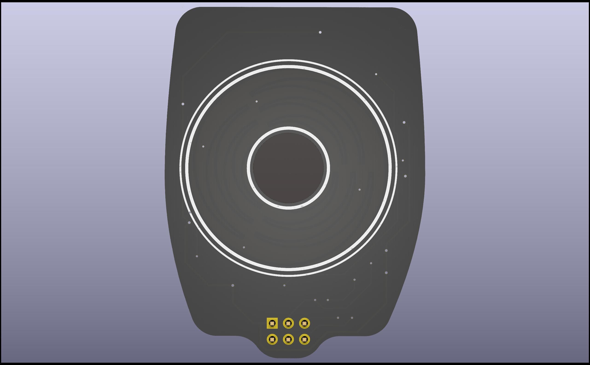
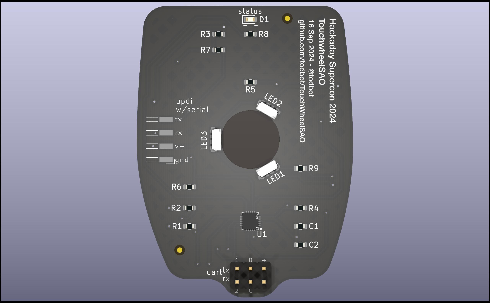
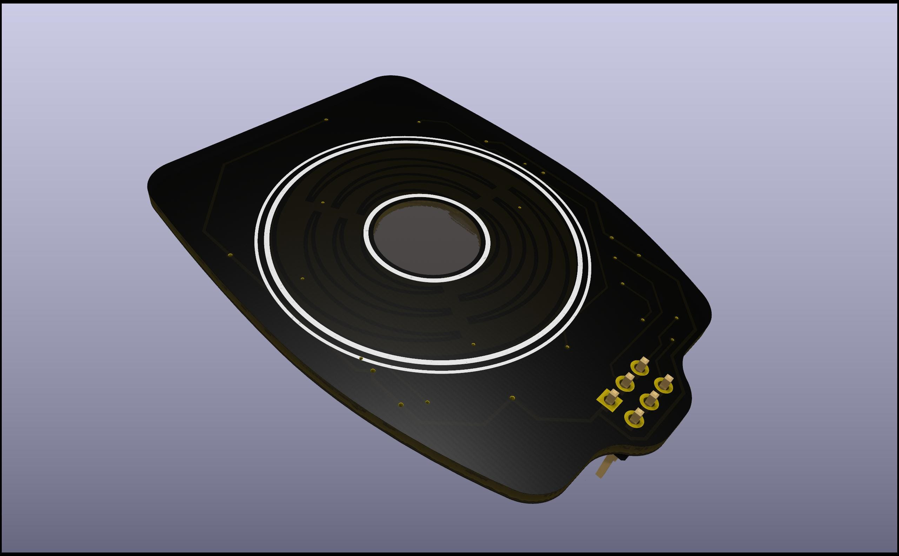
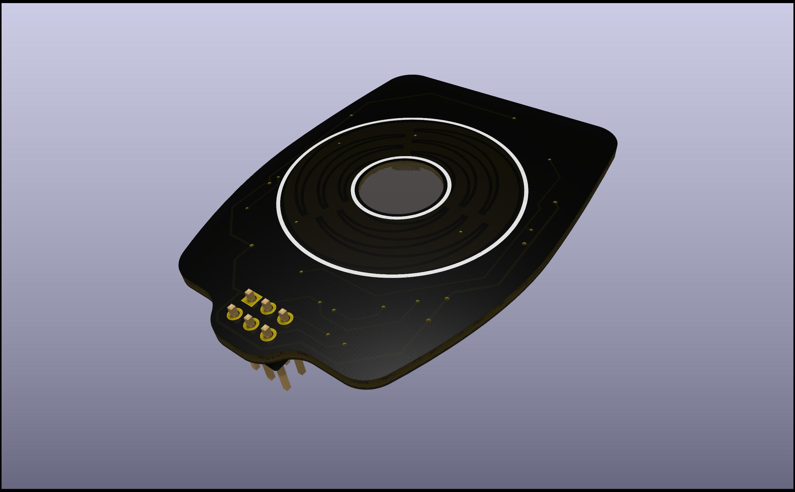
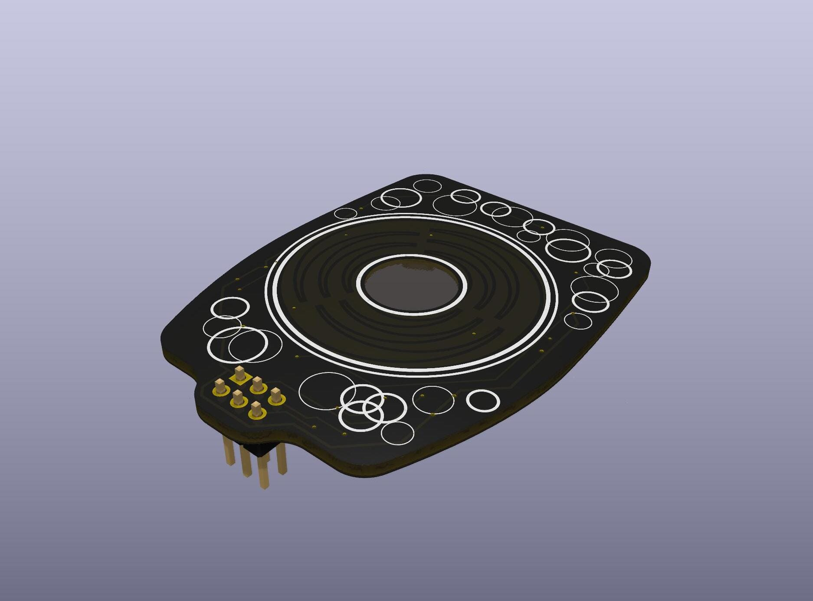
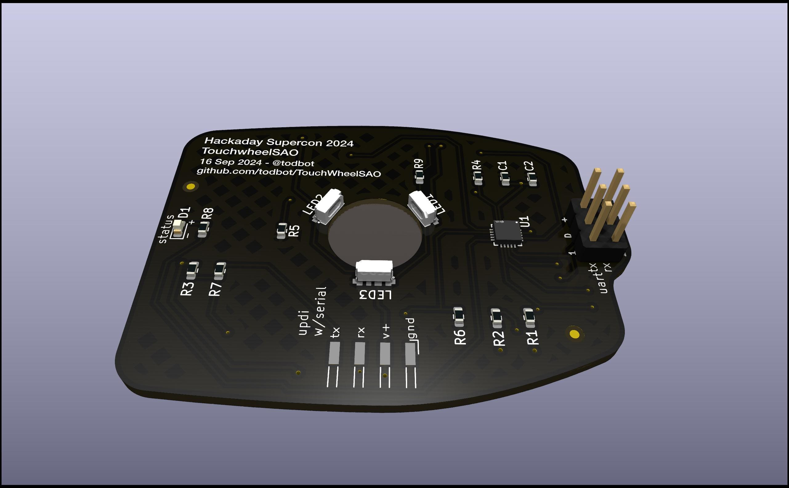

# TouchwheelSAO


Capacitive touchweel SAO for Hackaday Supercon 2024

### Features
- Three capacitive touch pads arranged in interleaved disk, builds on [touchwheel0](https://github.com/todbot/touchwheels)
- Three "Neopixel"-compatible side-light RGB LEDs that shine through the center
- Standard SAO pinout w/ I2C. Spare GPIO lines wired to UART TX/RX
- Finger position 0-255 readable via I2C, LEDs controllable via I2C. See [register map](https://github.com/todbot/TouchwheelSAO/blob/main/firmware/TouchwheelSAO_attiny816/TouchwheelSAO_attiny816.ino#L40) for details
- One status LED on back of board
- ATtiny816-based, same as [seesaw boards](https://learn.adafruit.com/adafruit-attiny817-seesaw)
- Easy compilation using standard Ardiuno toolchain and [megaTinyCore](https://github.com/SpenceKonde/megaTinyCore)
- Uses modified [TouchyTouch](https://github.com/todbot/TouchyTouch) captouch library, included


### Production details

* [View BOM](https://todbot.github.io/TouchwheelSAO/schematics/TouchwheelSAO/bom/ibom.html)
* [View SCH PDF](https://todbot.github.io/TouchwheelSAO/schematics/TouchwheelSAO/TouchwheelSAO_sch.pdf)
* Production files: [gerbers zip](https://todbot.github.io/TouchwheelSAO/schematics/TouchwheelSAO/production/TouchWheelSAO.zip), [bom csv](https://todbot.github.io/TouchwheelSAO/schematics/TouchwheelSAO/production/bom.csv), [positions csv](https://todbot.github.io/TouchwheelSAO/schematics/TouchwheelSAO/production/positions.csv)

### I2C protocol

The TouchwheelSAO is an I2C peripheral at address `0x54`, with a simple
register map:

- To write, send the register number, then one or more data bytes. The
  register number increments after each byte, so one write can fill several
  registers.
- To read, write the register number, then read one byte. Multi-byte reads
  only return the first register correctly (the rest read as `0xFF`), so
  read one register at a time.

#### Registers

| Reg   | Name           | R/W | Description                          |
|-------|----------------|-----|--------------------------------------|
| 0     | `POSITION`     | R   | Touch position 1-255, 0 if no touch  |
| 1     | `TOUCHES`      | R   | Bitfield of the 3 pads touched       |
| 2-7   | `RAW0L-RAW2H`  | R   | Raw count per pad, 16-bit, low first |
| 8-13  | `THRESH0L-2H`  | R   | Threshold per pad, 16-bit, low first |
| 14    | `LED_STATUS`   | R/W | Non-zero turns on the back LED       |
| 15-17 | `LED_RGBR/G/B` | R/W | Writing a channel sets it on all LEDs |
| 18-20 | `LED0_R/G/B`   | R/W | Color of LED 0 (fw v2+)              |
| 21-23 | `LED1_R/G/B`   | R/W | Color of LED 1 (fw v2+)              |
| 24-26 | `LED2_R/G/B`   | R/W | Color of LED 2 (fw v2+)              |
| 27    | `VERSION`      | R   | Firmware version (fw v2+)            |

Writes past register 27 are ignored, and reads past it return 0.

#### LED behavior

- Colors are 0-255 per channel, scaled down by the firmware's
  `LED_BRIGHTNESS`.
- While a pad is touched, the firmware sets all three LEDs to a color
  matching the touch position, overwriting whatever the host set.
- After a touch, all LED colors fade down for about half a second. Colors
  written during that fade also fade.
- On power up, the firmware plays a ~2 second startup animation. It answers
  I2C during the animation, but LED colors written then get overwritten.

#### Firmware versions

- v1 (original): registers 0-17 only. It has no `VERSION` register, and
  doesn't check register numbers, so writing to register 18 or above
  corrupts its memory.
- v2: adds the per-LED color registers 18-26 and `VERSION` at 27.
  Registers 0-17 behave the same as v1, so v1 host code still works.

To use the per-LED registers, read `VERSION` first and only write 18-26 if
it reads 2 or more. On v1, register 27 returns whatever is in memory there,
so it could read 2 or more by chance.

#### Example (MicroPython)

```py
from machine import I2C, Pin
i2c = I2C(0, scl=Pin(18), sda=Pin(17))  # your SAO's I2C pins
addr = 0x54

pos = i2c.readfrom_mem(addr, 0, 1)[0]  # 0 = no touch

i2c.writeto_mem(addr, 15, bytes([255, 0, 255]))  # all LEDs purple

if i2c.readfrom_mem(addr, 27, 1)[0] >= 2:  # per-LED colors, fw v2+
    i2c.writeto_mem(addr, 18, bytes([255,0,0, 0,255,0, 0,0,255]))
```


### Renders:

<a href="./docs/renders/TouchwheelSAO-render0.jpg"></a>
<a href="./docs/renders/TouchwheelSAO-render1.jpg"></a>
<a href="./docs/renders/TouchwheelSAO-render2.jpg"></a>
<a href="./docs/renders/TouchwheelSAO-render3.jpg"></a>
<a href="./docs/renders/TouchwheelSAO-render4.jpg"></a>
<a href="./docs/renders/TouchwheelSAO-render5.jpg"></a>

### Production version (cat approved):


https://github.com/user-attachments/assets/31f27016-510a-4a7b-9d95-70a69f371cc3


### Prototype Demo: 


https://github.com/user-attachments/assets/b0e4c4f9-f228-49bc-8d6e-ceb53a960fb6


## Prototype Renders

* Render2:

https://github.com/user-attachments/assets/08d6583a-afa1-4c01-aba5-ca108eea4f24

* Render1:

https://github.com/user-attachments/assets/c628ba94-1a07-43ad-b761-b3852f8f35f7

### Notes:

* Related to [touchwheel0](https://github.com/todbot/touchwheels)
* Uses ATtiny816, using [megaTinyCore](https://github.com/SpenceKonde/megaTinyCore) for Arduino
* 9Sep2024: Originally designed for QFN, but SOIC requested. ATtiny816 comes in hilariously wide SOIC
* 16Sep2024: Back to QFN for ATtiny816 for JLC assembly.
* 16Sep2024: SAO header must be hand switched to be same side ("top") as SMD in positions.csv for JLC to assemble it correctly

